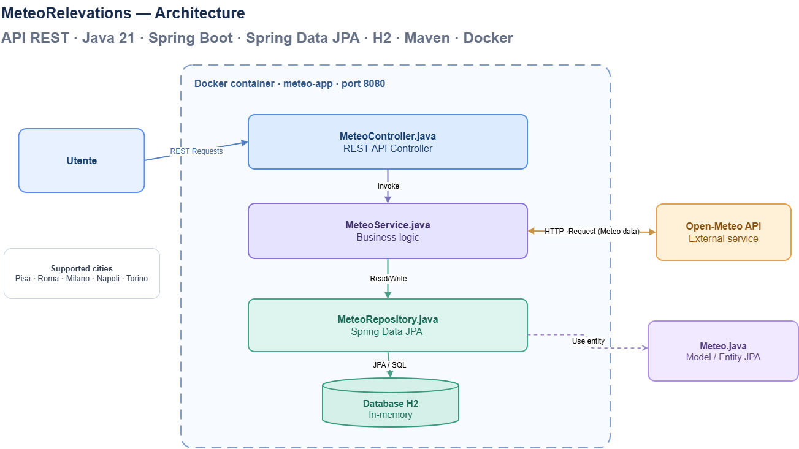

### **Meteo API REST**
Applicativo API REST sviluppato in Java/Spring che permette di rilevare e visualizzare i dati meteo relativi
alle citta fornite in input dall'utente. 
L'architettura dell'applicativo presenta una classe model (Meteo.java), che si occupa di modellare gli attributi
di una rilevazione in una tabella del DB; una classe controller (MeteoController.java), che fornisce all'esterno
gli endpoint REST con cui l'utente può interfacciarsi all'applicativo; un service (MeteoService.java), che si
occupa di eseguire le operazioni di business dell'applicativo; un repository (MeteoRepository.java), che
viene utilizzata dall'applicativo per interfacciarsi al database ed eseguire query SQL.

L'applicativo in questa versione supporta cinque città italiane: Pisa, Roma, Milano, Napoli, Torino. Le rilevazioni provengono dall'API Open-Meteo.  
L'applicazione è containerizzata attraverso docker. L'immagine contiene tutte le dipendenze necessarie per avviare
l'applicazione.

Lo stack tecnologico utilizzato comprende Java (SDK 21), Spring Boot, Spring Data JPA, H2, Maven, Docker, Git.  
Le API sono disponibili su http://localhost:8080.
Il db H2 è configurato in memoria, ossia si ha che i dati vengono persi quando l'applicazione si arresta.

### **Comandi**
Dalla cartella del progetto, contenente il Dockerfile, si eseguono i comandi:  
docker build -t meteo-app .  
docker run --name meteo-container -p 8080:8080 meteo-app  
Il Dockerfile compila il progetto con Maven e avvia il JAR generato. 

### **Endpoint REST**

**POST /api/meteo/rileva/{citta}**	Acquisisce e salva una rilevazione per una città  
**POST /api/meteo/rilevaAll**	Acquisisce e salva una rilevazione per tutte e cinque le città supportate  
**POST /api/meteo/rilevaLastHourAll**	Acquisisce e salva le rilevazioni delle ultime 5h per tutte e cinque le città supportate  
**GET /api/meteo/temperatura/{citta}**	Restituisce l'ultima temperatura registrata per una città  
**GET	/api/meteo/temperaturaMedia/{citta}**	Restituisce la temperatura media di una città  
**GET	/api/meteo/temperaturaMediaAll**	Restituisce le temperature medie delle cinque città supportate  

